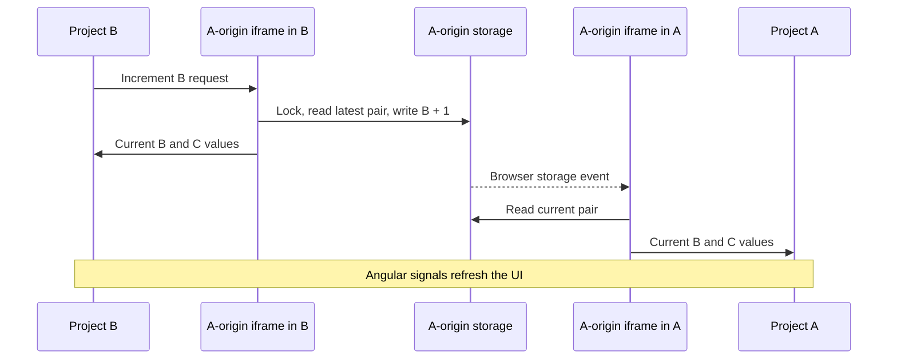

# Frontend microfrontend application

This workspace contains three independent Angular applications. Project A displays a todo list and the live Project B and Project C counter values. B and C each provide Increase, Decrease, and Reset buttons for their own counter. Updating B or C automatically updates A, including when they are open in separate tabs.

All counter data stays in the browser. Native Federation loads frontend modules at runtime. There is no backend API, database, counter server, or separate shared-counter package. The development processes serve frontend files.

## Project responsibilities

| Project | URL | Responsibility |
| --- | --- | --- |
| A | http://localhost:4200 | Todo list, live summary, counter state implementation, browser bridge |
| B | http://localhost:4201 | Control the B counter |
| C | http://localhost:4202 | Control the C counter |

There are no navigation menus. A opens its todo page by default. Its existing direct URLs `/counter-b` and `/counter-c` still load the remote counter components inside A, with its summary remaining visible.

Three mechanisms work together:

1. **Federation loads code:** B/C load A's state implementation, and A can load B/C's components.
2. **Angular signals update the UI:** templates read count, connection, pending, and error signals.
3. **The browser bridge synchronizes tabs:** hidden A-origin pages read and write the same localStorage entry and exchange messages with their parent applications.

Federation alone does not synchronize data between tabs. That is the bridge's responsibility.

## Install and start

Use Node.js compatible with the installed Angular CLI: `^22.22.3`, `^24.15.0`, or `>=26.0.0`. The package files specify npm 11.19.0.

From this workspace directory, install dependencies:

```powershell
npm --prefix Project-A ci
npm --prefix Project-B ci
npm --prefix Project-C ci
```

Open three terminals at the workspace directory. Run one command in each:

```powershell
npm --prefix Project-A start
```

```powershell
npm --prefix Project-B start
```

```powershell
npm --prefix Project-C start
```

Wait for all three to be ready, then open the URLs above in the same browser profile using localhost consistently. Reload any page opened before its dependencies were ready. A must be available for B/C to load its module and bridge. B/C must be available when their components are opened through A's direct routes.

## File map

| Location | Purpose |
| --- | --- |
| Each project's `src/main.ts` | Initialize federation before dynamically importing bootstrap |
| Each project's `src/bootstrap.ts` | Bootstrap the root Angular component |
| Each project's `src/app/app.config.ts` | Application providers |
| Each project's `src/app/app.ts`, `app.html`, `app.css` | Root behavior, template, presentation |
| Each project's `federation.config.js` | Exposed modules and dependency sharing |
| A's `public/federation.manifest.json` | Remote entry addresses for B/C |
| A's `src/app/app.routes.ts` | Todo and remote counter routes |
| A's `src/app/todo.ts`, `todo.html`, `todo.css` | Todo behavior and presentation |
| A's `src/app/counter-state.ts` | Actual counter state implementation |
| A's `public/counter-bridge.html`, `counter-bridge.js` | A-origin browser storage and messaging |
| B/C's `src/app/counter-state.ts` | Type-only interface describing A's public state |

Each project also contains its own package lock, Angular configuration, TypeScript configuration, global styles, and HTML entry page. The B/C interfaces do not implement a second service or duplicate the storage logic.

Project guides: [Project A](Project-A/README.md), [Project B](Project-B/README.md), [Project C](Project-C/README.md).

## Project A startup flow

1. The browser loads `src/main.ts`.
2. `initFederation('federation.manifest.json')` initializes federation using the public manifest. It maps project-b and project-c to their remote entries.
3. After the initialization attempt, main dynamically imports `bootstrap.ts`. Errors are logged to the console.
4. Bootstrap starts the root `App` with `app.config.ts`, which registers routing.
5. App calls `getCounterState()` from A's counter-state file.
6. That function returns `window.projectACounterState` if already present, otherwise creates and caches one object for this window.
7. The state constructor registers a message listener and creates a hidden iframe pointing to `http://localhost:4200/counter-bridge.html`.
8. Once the frame loads, the state sends a read request. The bridge replies with the saved B/C values.
9. The state updates Angular signals, and `app.html` renders the live summary.
10. The home route creates the Todo component inside `router-outlet`.

The summary belongs to the root, so it remains present when A changes routes. Routing does not create another root state object.

## Federation: what is loaded

A exposes `./CounterState` from `src/app/counter-state.ts`. B and C expose `./Counter` from their `src/app/app.ts` files. Builds generate `remoteEntry.json` and the exposed module files. Remote metadata describes code and dependencies; it does not contain the live counts.

The federation configuration uses `shareAll` with singleton dependencies and strict version matching. This supports compatible Angular/library use within federated modules. Separate browser tabs still have separate JavaScript windows and separate state objects.

`ignoreUnusedDeps: false` preserves dependencies needed by dynamic bootstrap and remote loading. The skip list excludes unused animation and RxJS entry points. These entries belong to build configuration and are not application functionality.

### B/C running in their own tabs

Their main files initialize federation and dynamically import bootstrap. In `App.ngOnInit()`, the component checks for A's state on the current window. Normally it is absent in a standalone tab, so the component loads A's exposed module:

```typescript
const module = await loadRemoteModule({
  remoteEntry: 'http://localhost:4200/remoteEntry.json',
  exposedModule: './CounterState',
});
this.counters.set(module.getCounterState());
```

A's module executes in that tab and creates its state object and hidden A-origin frame. Loading code from A does not change the top-level B/C page's origin.

### B/C running inside A

A's router loads the remote component using `loadRemoteModule('project-b', './Counter')` or the corresponding C name. The component executes in A's window, detects `window.projectACounterState`, and reuses it immediately.

This prevents a second state object or iframe in the same window and avoids another state federation load from inside the embedded component. Its count display and A's summary read the same signals.

## Exact counter update flow

Clicking Increase in B follows these steps:

1. B's template calls `increment()`.
2. The method forwards `update('b', 'increment')` to A's loaded state object.
3. `update()` ignores the action if disconnected or already pending. Otherwise it marks pending and starts a reply timeout.
4. `send()` posts the action and channel to the hidden iframe at A's exact origin.
5. The bridge validates the sender window, allowed origin, channel, project key, and action.
6. It requests a Web Lock named `project-a-counters`.
7. Within the lock, it reads the latest B/C pair from localStorage and increments B only.
8. It validates the resulting count as a safe integer and saves both values.
9. It sends the pair directly to its own parent.
10. The browser sends storage events to other A-origin bridge pages using that storage area. Each reads the current pair and forwards it to its own parent.
11. Each state's `receive()` validates the source iframe, origin, channel, and numeric values.
12. It updates the counts and connection signal, clears pending/error, and cancels the timeout.
13. Angular refreshes every template reading those signals, including A's summary.

C uses the same flow with the project key `c`. Decrease subtracts one; Reset changes only that project's value to zero. Negative counts are permitted.



### Why an iframe is necessary

A browser origin includes the port. Consequently, localhost:4201 and localhost:4200 have different localStorage areas. B cannot read A's storage by accessing localStorage directly.

Every application instead embeds the bridge served by A. Those frames execute on A's origin and access the same storage area. Parents and frames communicate through `postMessage`, with origin and source validation.

The bridge accepts configured localhost/127.0.0.1 origins on ports 4200, 4201, and 4202. The current state code always uses localhost:4200 for its bridge URL, so follow the documented localhost setup consistently.

### Why a Web Lock is necessary

Without serialization, two tabs could both read the same old value and overwrite each other's increments. The lock makes the second update read the value written by the first. The direct reply is also necessary: the document performing a storage write does not receive its own storage event.

## Counter state and bridge functions

| Function or listener | Responsibility |
| --- | --- |
| `getCounterState()` | Reuse or create one state object per window |
| `CounterState.constructor()` | Register replies, create iframe, request initial state |
| `update(project, action)` | Guard updates, mark pending, send action |
| `send(message)` | Add channel and post to the bridge's exact origin |
| `receive(event)` | Validate replies and update signals |
| `waitForReply()` | Start or restart a 10-second reply timeout |
| Bridge `readCounts()` | Read the pair, default missing storage to zeros, validate values |
| Bridge `sendCounts()` | Send the current pair to its parent |
| Bridge `sendError()` | Notify its parent of synchronization failure |
| Bridge message listener | Validate requests and perform locked updates |
| Bridge storage listener | Forward values changed by another frame |

The signals are `countB`, `countC`, `connected`, `pending`, and `error`. Counts initially equal zero in memory, but templates show a dash until a valid connection reply arrives. Buttons are disabled while disconnected or pending. Safe-integer validation prevents numeric overflow from being saved.

The state lives for the lifetime of its browser window. The window cache allows the root and embedded components to reuse it throughout route changes.

## Todo list flow

The todo component uses ordinary component memory. An item contains `id`, `text`, and `completed`. `newTask` holds input, `tasks` holds items, and `nextId` supplies stable IDs.

### Add

`FormsModule` enables `[(ngModel)]="newTask"`, so typing updates the property. The form's `(ngSubmit)` calls `addTask()`, including when Enter is pressed. This method trims spaces, ignores blanks, appends an incomplete item with a new ID, and clears the input. The Add button is disabled for blank input.

`@for (task of tasks; track task.id)` renders the list. Stable IDs identify each row. The `@empty` branch displays the empty-list message.

### Complete or reopen

The checkbox's change event calls `toggleTask(task)`, which reverses the completed flag. The checkbox's checked binding and the completed CSS class follow that value.

### Delete

The button calls `removeTask(task.id)`. Filtering removes that ID from the list. Its accessible label includes the task text.

Todo items are not persisted. Reloading A or leaving and recreating the todo route clears the list. Counter changes do not change todo items.

## Persistence and practical example

The bridge stores a pair under the localStorage key `project-a-counters`:

```json
{"b":3,"c":-1}
```

With fresh storage both values are zero. Increase B three times and decrease C once: A shows B = 3 and C = -1. Reloading restores that pair. Resetting B produces B = 0 and C = -1.

Counter values survive reloads and development-process restarts. Clearing A's site storage removes that persistence. Different browser profiles and computers have independent data.

Synchronization requires the browser to make the same A-origin storage area available to the frames. Use Chrome or Edge with browser storage enabled in this localhost setup. Policies that block or partition iframe storage can affect synchronization.

## Build and configuration

```powershell
npm --prefix Project-A run build
npm --prefix Project-B run build
npm --prefix Project-C run build
```

The Native Federation builder creates exposed modules and metadata alongside Angular's application build. Each project's angular.json defines its development port and output directory under its own `dist/Project-X`.

Each package now has only `start` and `build` scripts. TypeScript configuration includes application source. Editor launch configurations use the appropriate port.

For deployment to different addresses, update A's manifest, B/C's state remote URL, A's bridge origin constant, and the bridge's allowed origins together. Serve the bridge from A's origin, permit iframe loading, and configure hosting to support Angular's direct routes. The current URLs are intended for local development.

## Loading, errors, and troubleshooting

B/C show a loading message before their remote state arrives. If loading fails, they ask the user to start A and reload. Once loaded, the state supplies connection/storage errors to the templates. Counter changes use aria-live regions, and errors use alert semantics.

| Symptom | Action or explanation |
| --- | --- |
| State module fails to load | Start A on 4200, wait for readiness, reload B/C |
| Reply timeout after 10 seconds | Check A and bridge loading, then reload |
| Browser synchronization unavailable | Check storage permissions and Web Locks support; use Chrome or Edge |
| Direct remote counter route fails | Start the corresponding B/C project and check the manifest |
| Different browsers show different counts | Their browser storage is independent |
| Todo disappears after reload | Todo data intentionally exists only in memory |

Invalid numeric stored values fall back to zeros. Malformed JSON or storage failures produce an error reply. Federation initialization errors are logged to the console; remote-state loading errors also appear in B/C's UI.

## Suggested code reading order

Start with A's `app.ts` and `app.html`, then `todo.ts` and `todo.html`. Read A's `counter-state.ts` together with `public/counter-bridge.js` to follow synchronization. Finally read B/C's `app.ts`, templates, federation configurations, and A's route file to see how the frontend pieces connect.
