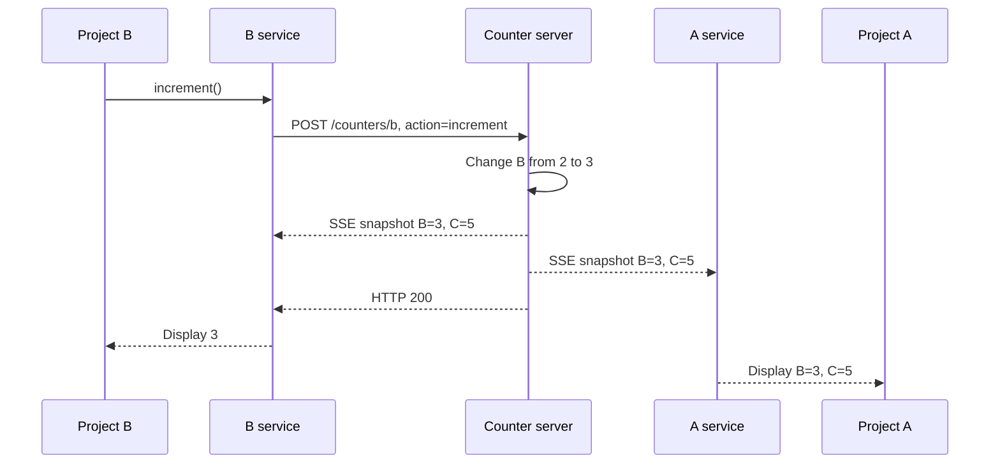

# Project A, B, and C: Detailed functionality guide

This workspace contains three Angular applications, a shared Angular counter service,
and a small Node.js counter API. Project A displays a todo list and live counter values.
Projects B and C control two independent counters. Updating a counter also updates
Project A, including when the applications are open in separate browser tabs.

## Contents

1. [Application structure](#1-application-structure)
2. [Installation and startup](#2-installation-and-startup)
3. [Project A functionality](#3-project-a-functionality)
4. [Project B and C functionality](#4-project-b-and-c-functionality)
5. [Native federation](#5-native-federation)
6. [Shared counter service](#6-shared-counter-service)
7. [Counter server and API](#7-counter-server-and-api)
8. [Example of a complete update](#8-example-of-a-complete-update)
9. [Data lifetime and limitations](#9-data-lifetime-and-limitations)
10. [Important files](#10-important-files)
11. [Builds and tests](#11-builds-and-tests)
12. [Troubleshooting](#12-troubleshooting)

## 1. Application structure

| Folder | Role | Responsibility |
| --- | --- | --- |
| [Project-A](Project-A/README.md) | Host application, also called the shell | Todo list, live B/C summary, and routes that can load remote counters |
| [Project-B](Project-B/README.md) | Remote micro frontend and standalone application | Display and controls for counter B |
| [Project-C](Project-C/README.md) | Remote micro frontend and standalone application | Display and controls for counter C |
| `shared-counter` | Local package named `@demo/shared-counter` | Shared injection token, reactive values, and API communication |
| `counter-server` | Local Node.js HTTP server | Actual counter values, action handling, and live broadcasts |

A **micro frontend** is an independently built frontend that another application can
load. B and C run independently, and A can load their counter components at runtime.

The server holds the counter values. A's summary reads those values; it has no
increment, decrement, or reset buttons.

## 2. Installation and startup

### Prerequisites

The installed Angular CLI is version 22.2.2. Its Node.js engine requirement is:

```text
^22.22.3 || ^24.15.0 || >=26.0.0
```

Node.js 24.21.0, for example, satisfies that requirement. The project package files
declare npm 11.19.0 as their package manager.

Check the installed versions:

```powershell
node --version
npm --version
```

### Install dependencies

Run from the workspace root:

```powershell
npm install --prefix ./Project-A
npm install --prefix ./Project-B
npm install --prefix ./Project-C
```

Each Angular project depends on `file:../shared-counter`. Keep that folder alongside
A, B, and C when copying the workspace.

Each Angular project's `.npmrc` contains `install-links=true`. The local shared
package is installed as a package copy in the consumer's `node_modules`, rather
than a directory symlink. Its Angular peer dependency uses the consumer's Angular
installation.

The counter server uses built-in Node.js modules and requires no dependency
installation. The shared service package has no separate development server.

### Start all four processes

Open four terminals at the workspace root. Run one command in each terminal:

| Terminal | Command | Purpose |
| --- | --- | --- |
| 1 | `npm start --prefix ./counter-server` | Counter API and live updates |
| 2 | `npm start --prefix ./Project-B` | Counter B and its federation entry |
| 3 | `npm start --prefix ./Project-C` | Counter C and its federation entry |
| 4 | `npm start --prefix ./Project-A` | Todo list, live summary, and host |

Start the API and both remotes before A for the complete demo. B or C can run
independently with just the API.

| URL | What it displays |
| --- | --- |
| [localhost:4200](http://localhost:4200/) | A: todo list and live counter summary |
| [localhost:4201](http://localhost:4201/) | B: counter controls |
| [localhost:4202](http://localhost:4202/) | C: counter controls |
| [127.0.0.1:4300/counters](http://127.0.0.1:4300/counters) | JSON snapshot of the actual counts |

Stop a process with Ctrl+C in its terminal. Do not start a second process on a port
already used by this demo.

### Try the functionality

1. Open A, B, and C in separate browser tabs.
2. In A, add a task, mark it complete, and delete it.
3. In B, click **+**. A's B value updates automatically.
4. In C, click **−**. A's C value updates automatically.
5. Reset B. C keeps its own value.
6. Reload A. Its todo list is empty, but its counter values return from the server.

## 3. Project A functionality

### Visible page and routes

A's home page contains a heading, a live counter summary, and the todo list.
The navigation links were removed. The routes still exist and can be opened
by typing their URLs:

| URL | Content below the live summary |
| --- | --- |
| `http://localhost:4200/` | Local todo component |
| `http://localhost:4200/counter-b` | B's counter loaded through federation |
| `http://localhost:4200/counter-c` | C's counter loaded through federation |

Unknown paths redirect to the home page. The summary is outside the router outlet
in A's root component, so it stays visible on every route.

### Todo state

The [todo component](Project-A/src/app/todo.ts) keeps three properties:

```typescript
newTask = '';
tasks: TodoItem[] = [];
private nextId = 1;
```

Each task has this shape:

```typescript
interface TodoItem {
  id: number;
  text: string;
  completed: boolean;
}
```

`newTask` holds the input text. `tasks` holds the current list.
`nextId` assigns a distinct ID to each new task during the component's lifetime.

### Todo methods

| Method | Behavior |
| --- | --- |
| `addTask()` | Trims input, ignores blank text, adds an incomplete task, advances the ID, and clears the input |
| `toggleTask(task)` | Changes completed from false to true, or true to false |
| `removeTask(id)` | Replaces the list with every task except the matching ID |

For example, entering `"  Learn Angular  "` creates `"Learn Angular"`.
An input containing only spaces creates no task. Tasks can have identical text
because their IDs distinguish them.

### How todo HTML connects to the component

| Template expression | Meaning |
| --- | --- |
| `[(ngModel)]="newTask"` | Synchronizes the input and the component's text property |
| `(ngSubmit)="addTask()"` | Adds a task when Add is clicked or Enter submits the form |
| `[disabled]="!newTask.trim()"` | Disables Add for blank input |
| `@for (task of tasks; track task.id)` | Renders tasks using their IDs |
| `[checked]="task.completed"` | Shows the checkbox's current state |
| `(change)="toggleTask(task)"` | Toggles task completion |
| `[class.completed]="task.completed"` | Applies completed styling, including a line through the task |
| `(click)="removeTask(task.id)"` | Deletes the selected task |
| `@empty` | Shows the empty-list message |

`FormsModule` supplies the form bindings. Todo operations are local; they do not
call the counter API.

### Live counter summary

A's [root component](Project-A/src/app/app.ts) injects the shared service:

```typescript
counters = inject(COUNTER_SERVICE);
```

Its template reads `counters.countB()` and `counters.countC()`.
Calling a signal with parentheses reads its current value.

A displays `—` until a live snapshot arrives, and while disconnected.
It shows a connecting message initially and an error after a connection failure.
It does not present an initial or cached number as a current server value.

The counter values use `aria-live="polite"` so assistive technology can announce
changes. Error messages use `role="alert"`.

## 4. Project B and C functionality

Both apps contain a count and three buttons. They use different server keys:

| Button | B's request | C's request | Result |
| --- | --- | --- | --- |
| + | `update('b', 'increment')` | `update('c', 'increment')` | Add one |
| − | `update('b', 'decrement')` | `update('c', 'decrement')` | Subtract one |
| Reset | `update('b', 'reset')` | `update('c', 'reset')` | Set that counter to zero |

Negative values are allowed. Each change uses a step of one.
Resetting B does not reset C, and resetting C does not reset B.

### Component methods and signals

B uses:

```typescript
counters = inject(COUNTER_SERVICE);
count = this.counters.countB;

increment() {
  void this.counters.update('b', 'increment');
}
```

Its `decrement()` and `reset()` methods send their corresponding action names.
C uses `countC` and the project key `'c'`.

`count` references the service's signal; it is not a copied number.
When the service receives new server data, the component's `count()` display changes.

`update()` returns a promise because it makes an HTTP request. The component uses
`void` because it does not consume the result. The service handles request errors.

### Disabled buttons and error display

All buttons are disabled when:

```typescript
!counters.connected() || counters.pending()
```

The live connection must be ready, and that service instance must not already
have a request in progress. `pending` is local to an instance; it does not lock
every separate browser tab.

When offline, the number displays `—`. A failed request produces an error.
The component does not calculate an optimistic local count; its value comes from
the server's live snapshot.

### Standalone and embedded modes

On port 4201 or 4202, a remote boots as its own Angular application.
Its root HTML element is `app-counter-b` or `app-counter-c`.

On A's remote route, A loads the exported counter component and renders it in
its router outlet. The remote's independent application bootstrap is not used
to render that component inside A.

## 5. Native federation

Federation loads independently built frontend code at runtime.

### Exposing the remote components

B and C each configure:

```javascript
exposes: {
  './Counter': './src/app/app.ts',
}
```

`'./Counter'` is the public module name. The source exports a component class
named `App`. The federation build produces a `remoteEntry.json` describing
the exposed modules and shared dependencies. That file does not contain live
counter data.

### Finding remotes from A

A's [manifest](Project-A/public/federation.manifest.json) maps names to URLs:

```json
{
  "project-b": "http://localhost:4201/remoteEntry.json",
  "project-c": "http://localhost:4202/remoteEntry.json"
}
```

A's `main.ts` initializes federation with this manifest, then imports
`bootstrap.ts`. The bootstrap calls `bootstrapApplication(App, appConfig)`.
A's application configuration registers the router and browser error listeners.

B and C initialize federation without A's manifest when starting independently.
Their application configurations do not register a router because the standalone
counter pages have no routes.

The startup code logs federation initialization errors and still attempts to
bootstrap. Missing remotes cause console errors and prevent those remote routes
from loading. The local todo component does not depend on a remote component.

### Loading a remote on demand

A's B route uses:

```typescript
loadComponent: () =>
  loadRemoteModule('project-b', './Counter').then(module => module.App)
```

The loader finds B through the manifest, loads its exposed module, and returns
the component for the router. C follows the same pattern.

### Sharing one package and injection token

Every federation configuration includes:

```javascript
'@demo/shared-counter': {
  singleton: true,
  strictVersion: true,
  requiredVersion: '1.0.0',
}
```

| Setting | Purpose |
| --- | --- |
| `singleton` | Reuses one shared package in the federated application |
| `strictVersion` | Enforces compatible versions during shared-package resolution |
| `requiredVersion` | Declares the expected version of the local package |

`shareAll(...)` configures the other application dependencies for sharing.
The `skip` list excludes unused RxJS entry points.

Sharing the package preserves the identity of `COUNTER_SERVICE`. An embedded
remote obtains the root service from A's Angular injector instead of creating
an unrelated counter store.

### Why separate tabs also need the API

Separate Angular applications have separate root injectors and JavaScript memory.
A standalone B tab does not share A's service instance.

All instances connect to the same API. Federation shares components and packages
inside a federated application; the API's event stream synchronizes separate apps
and browser tabs.

## 6. Shared counter service

The service lives in [shared-counter/index.js](shared-counter/index.js).
[index.d.ts](shared-counter/index.d.ts) supplies TypeScript declarations for
the JavaScript package, including accepted project keys and action names.

### Signals

| Signal | Initial value | Purpose |
| --- | --- | --- |
| `countB` | `0` | Last received B value |
| `countC` | `0` | Last received C value |
| `connected` | `false` | A snapshot has arrived and the stream has not reported a connection error |
| `error` | Empty string | UI message for a connection or request error |
| `pending` | `false` | An action request is in progress in this instance |

Signals are reactive values. Calling `.set(value)` changes a signal, and Angular
updates templates that read it.

### Injection and lifecycle

`COUNTER_SERVICE` is an `InjectionToken` provided in the root injector.
Its factory runs when it is first injected:

1. Create a `CounterService`.
2. Call `connect()`.
3. Use `DestroyRef` to register `close()` when the owning injector is destroyed.
4. Return the instance.

Later injections in that injector reuse the service. Changing A's page route
does not destroy its root service.

### All service methods

| Method | Behavior |
| --- | --- |
| `connect()` | Opens one `EventSource` to `http://127.0.0.1:4300/events`; does nothing if a stream already exists |
| `applyCounts(counts)` | Sets both count signals from a snapshot such as `{ b: 3, c: 1 }` |
| `update(project, action)` | Skips requests while offline or pending; sets pending; POSTs an action; records failures; clears pending in `finally` |
| `close()` | Closes the stream, clears its reference, and marks the service disconnected |

On a message, `connect()`'s handler parses the JSON, applies both counts, marks
the connection ready, and clears the error.

On a stream error, its error handler marks the service disconnected and displays
the offline message. The browser's `EventSource` automatically attempts to
reconnect. The next snapshot restores the connected display.

### Why the action response does not set the count

The POST confirms that the server accepted the action. Counts are updated through
the ordered event stream, including the event caused by the sender's own request.
This keeps clients following server snapshots instead of calculating separate
local versions.

## 7. Counter server and API

[counter-server/server.js](counter-server/server.js) uses Node's built-in HTTP
module and binds to the loopback address `127.0.0.1:4300`.

It stores:

```javascript
const counts = { b: 0, c: 0 };
const subscribers = new Set();
```

`counts` contains actual values. `subscribers` contains open event responses.

### Endpoints

| Method | Path | Behavior |
| --- | --- | --- |
| GET | `/counters` | Return the current JSON snapshot |
| GET | `/events` | Open a live stream and immediately send the current snapshot |
| POST | `/counters/b` | Apply an action to B and broadcast both values |
| POST | `/counters/c` | Apply an action to C and broadcast both values |
| OPTIONS | Requested path | Handle browser CORS preflight |

Example request body:

```json
{ "action": "increment" }
```

Example JSON response:

```json
{ "b": 1, "c": 0 }
```

The accepted actions are `increment`, `decrement`, and `reset`.

### Server-sent events

Server-sent events (SSE) keep an HTTP response open so the server can push changes.
The browser's `EventSource` receives them. Actions travel in separate POST requests.

An event contains JSON prefixed by `data:` and ends with a blank line:

```text
data: {"b":1,"c":0}

```

After every valid action, the server broadcasts a snapshot to each subscriber.
It writes a keep-alive comment every 15 seconds; this does not change the counts.
Disconnecting a client clears its heartbeat timer and removes its subscription.

The server applies each action to its own current value. Two tabs sending
increment requests cause two increments, rather than overwriting the count with
a stale number calculated by either browser.

### Validation and CORS

| Condition | Response |
| --- | --- |
| Valid action | `200`, counts, and a live broadcast |
| Invalid JSON or unknown action | `400` |
| Body exceeds the code's 1,024-character length check | `413` |
| Present Origin header is outside the allowed list | `403` |
| Unknown endpoint or unsupported method outside preflight | `404` |
| CORS preflight | `204` |

Allowed browser origins are `localhost` and `127.0.0.1` on ports 4200, 4201,
and 4202. Different ports are different origins. CORS allows those browser apps
to call the common API. Responses include `Cache-Control: no-store`.

Requests without an Origin header are not rejected by the origin check.
There is no login, database, or per-user counter allocation.

## 8. Example of a complete update

Suppose the server holds `{ b: 2, c: 5 }` and B is open in a separate tab.



1. Clicking + calls B's `increment()`.
2. The service sets pending and sends the action.
3. The server updates B to 3; C remains 5.
4. Every connected service receives the snapshot.
5. Each service sets its B/C signals.
6. Angular updates the displayed numbers.
7. The request finishes and the sender clears pending.

If B is embedded inside A, both components read A's root service instead of
two separate services. The visible result is the same.

## 9. Data lifetime and limitations

| Data | Stored where | Browser reload | Leaving A's todo route | API restart |
| --- | --- | --- | --- | --- |
| Todo tasks | Todo component memory | Cleared | Cleared when that component is destroyed | Unaffected in an already open todo component |
| B/C counts | API process memory | Received again from server | Preserved on server | Both reset to zero |
| Last received signals | Each root counter service | Recreated and synchronized | Root instance stays alive | Updated after reconnect |
| Error/connection/pending state | Each root counter service | Recreated | Root instance stays alive | Connection state changes |

Todos are local to A. They are not shared with B or C and are not saved to storage.
All clients connected to one server see the same counters.
A newly opened tab receives current counts, not necessarily zero.

The addresses and allowed origins are configured for a local demo.
Changing ports or moving to another host requires coordinated configuration changes.
There is no custom counter step, history, persistent database, or separate counter
state for each user.

## 10. Important files

| File | Purpose |
| --- | --- |
| [Project-A/src/app/todo.ts](Project-A/src/app/todo.ts) | Todo state and methods |
| [Project-A/src/app/todo.html](Project-A/src/app/todo.html) | Form, checkbox, delete action, and empty state |
| [Project-A/src/app/app.ts](Project-A/src/app/app.ts) | Root service injection |
| [Project-A/src/app/app.html](Project-A/src/app/app.html) | Live summary and router outlet |
| [Project-A/src/app/app.routes.ts](Project-A/src/app/app.routes.ts) | Home, remote routes, and fallback |
| [Project-A/src/main.ts](Project-A/src/main.ts) | Federation initialization |
| [Project-A/src/bootstrap.ts](Project-A/src/bootstrap.ts) | Angular bootstrap |
| [Project-A/src/app/app.config.ts](Project-A/src/app/app.config.ts) | Router and browser error-listener providers |
| [Project-A/public/federation.manifest.json](Project-A/public/federation.manifest.json) | Remote addresses |
| [Project-B/src/app/app.ts](Project-B/src/app/app.ts) | B signal and action methods |
| [Project-C/src/app/app.ts](Project-C/src/app/app.ts) | C signal and action methods |
| [shared-counter/index.js](shared-counter/index.js) | Service, signals, requests, and injection token |
| [shared-counter/index.d.ts](shared-counter/index.d.ts) | Service type declarations |
| [shared-counter/package.json](shared-counter/package.json) | Package identity, exports, and Angular peer dependency |
| [counter-server/server.js](counter-server/server.js) | API state and broadcasts |
| Each `federation.config.js` | Exposed modules and shared dependencies |
| Each `angular.json` | Build targets, ports, styles, assets, and test target |
| Each `src/styles.css` and component CSS | Basic presentation styles |

Start reading with `todo.ts`, B's `app.ts`, the shared service, the server,
and then A's template and federation configuration.

## 11. Builds and tests

Run from the workspace root:

```powershell
npm run build --prefix ./Project-A
npm run build --prefix ./Project-B
npm run build --prefix ./Project-C

npm test --prefix ./Project-A -- --watch=false
npm test --prefix ./Project-B -- --watch=false
npm test --prefix ./Project-C -- --watch=false
npm test --prefix ./counter-server
```

The federation builder wraps each Angular application build.
Output goes to that project's `dist/Project-A`, `dist/Project-B`, or
`dist/Project-C` directory; browser files are in its `browser` subfolder.
Federation also generates remote entries and shared-module artifacts.

Angular tests use Vitest and Angular TestBed with the underlying development
`esbuild` target. Server tests use Node's built-in test runner.

| Test area | What it checks |
| --- | --- |
| A root component | Summary signal updates and offline display |
| Todo | Add, trim, complete, delete, and ignore blank text |
| Shared service | Incoming events, failure/recovery, cleanup, requests, and request errors |
| B and C | Action keys, incoming counts, independence, and disabled offline controls |
| API integration | Two live subscribers, independent counters, concurrent increments, reset, invalid actions, and origin rejection |

Angular tests replace the service or browser network APIs with controlled substitutes.
The API integration test uses real HTTP requests and event streams against a server
on a temporary port. It does not alter the running demo's data.

## 12. Troubleshooting

| Symptom | Check |
| --- | --- |
| A or a counter shows an offline message | Start the API and open `http://127.0.0.1:4300/counters` |
| A cannot load a remote route | Start B/C and check its `remoteEntry.json` |
| No B/C navigation links | Current design: open separate apps or type a remote route URL |
| Port already in use | Use the existing demo process or stop it before starting another |
| Shared package cannot be found | Keep its folder beside the projects and reinstall dependencies |
| Shared-service edits do not appear | Its installed package is a copy; reinstall/repack it in each consumer and restart dev servers |
| Requests fail after changing ports | Update allowed origins and the matching frontend/remote addresses |
| Todos disappear | They are in component memory and clear on reload or component destruction |
| Counts reset to zero | The API process was restarted |
| Action request fails | Check the API; failed actions are not automatically retried |

In browser developer tools, look for action requests to `/counters/b` or
`/counters/c`, and the persistent `GET /events` stream that supplies live values.
